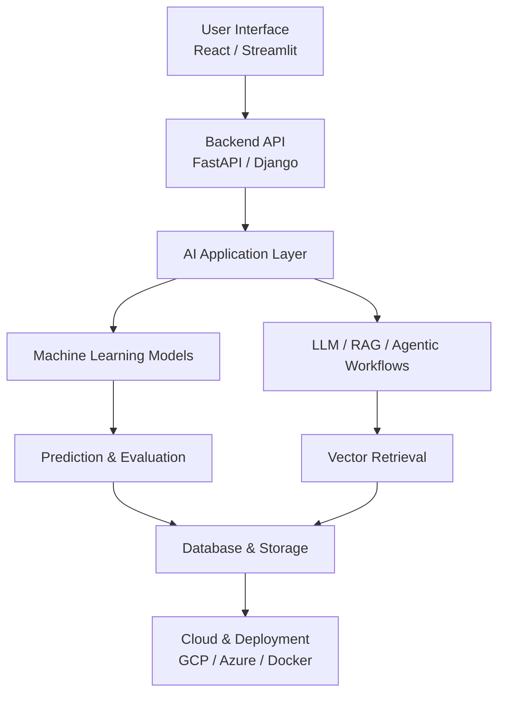

# Ittyavira C Abraham

<p align="center">
  
</p>

<p align="center">
  
  
  
</p>

---

## `01 // SYSTEM INITIALIZATION`

```bash
ittyavira@github:~$ whoami

AI/ML Engineer | MCA Artificial Intelligence Graduate

ittyavira@github:~$ cat introduction.txt

I design and develop intelligent systems using Machine Learning,
Deep Learning, Generative AI, RAG, and modern backend technologies.

My focus:
  [✓] Machine Learning & Deep Learning
  [✓] LLM Applications & RAG
  [✓] Agentic AI Exploration
  [✓] AI-powered Application Development
  [✓] Model Deployment & API Development

ittyavira@github:~$ _
```

## `02 // NEOFETCH`

<table>
<tr>
<td width="35%" align="center" valign="middle">


**ITTYAVIRA@GITHUB**

<sub>AI ENGINEER / DEVELOPER</sub>

</td>
<td valign="middle">

```yaml
OS:        Human OS 2.0
Host:      Kottayam, Kerala, India
Education: MCA - Artificial Intelligence
Shell:     Zsh / Python
Role:      AI/ML Engineer
Focus:     Generative & Agentic AI
Languages: Python, SQL, JavaScript, C
AI Stack:  TensorFlow, PyTorch, Scikit-learn
LLMs:      Hugging Face, LangChain, Ollama
Backend:   FastAPI, Django, Flask
Database:  PostgreSQL, MongoDB, MySQL
Cloud:     GCP, Microsoft Azure
Tools:     Git, Docker, VS Code
Status:    Building & Learning
```

</td>
</tr>
</table>

---

## `03 // CORE AI CAPABILITIES`

| Domain | Technologies & Focus |
|---|---|
| Machine Learning | Scikit-learn, XGBoost, model evaluation |
| Deep Learning | TensorFlow, Keras, PyTorch |
| Generative AI | LLMs, Hugging Face, Prompt Engineering |
| RAG & AI Agents | LangChain, LangGraph, retrieval pipelines |
| NLP | BERT, Transformers, text classification |
| Backend Engineering | FastAPI, Django, Flask |
| Data Engineering | Python, SQL, PostgreSQL, MongoDB |
| Deployment | Docker, GCP, Azure, API integration |
| Reinforcement Learning | Q-Learning, reward engineering, policy evaluation |

---

## `04 // FEATURED ENGINEERING PROJECTS`

### `01. Reinforcement Learning – Dynamic Pricing`

**Category:** Reinforcement Learning / Decision Intelligence

Developed a Q-Learning-based retail pricing environment to investigate how an intelligent agent learns pricing decisions under changing market conditions.

- Designed a 60-day retail simulation environment.
- Implemented Q-Learning with three pricing actions: 0.90x, 1.00x and 1.10x.
- Experimented with price-change penalties and stockout penalties.
- Evaluated agent performance across multiple random seeds.
- Conducted robust penalty experiments with held-out evaluation.

**Technologies:** Python, Reinforcement Learning, Q-Learning, NumPy, Streamlit, Pytest.

**Repository:** Add your public repository URL here.

### `02. LangChain RAG Assistant`

**Category:** Generative AI / Retrieval-Augmented Generation

Built a Retrieval-Augmented Generation assistant as part of practical LLM engineering work.

- Explored document-based knowledge retrieval.
- Integrated LLM-based response generation.
- Worked with LangChain and RAG concepts.
- Focused on grounding generated responses in retrieved context.

**Technologies:** Python, LangChain, LLMs, RAG.

**Repository:** Add your public repository URL here.

### `03. BERT-Based News Classification`

**Category:** NLP / Transformer Models

Developed a news classification project using transformer-based NLP techniques.

- Implemented text preprocessing and tokenization.
- Worked with Hugging Face Transformers.
- Evaluated classification performance using F1-score and confusion matrices.

**Technologies:** Python, BERT, Hugging Face, NLP, Transformers.

**Repository:** Add your public repository URL here.

### `04. Predicting Safety Stocks`

**Category:** Machine Learning / Forecasting

Developed an inventory forecasting approach combining traditional statistical forecasting and machine learning.

- Explored XGBoost for predictive modelling.
- Integrated SARIMA and LSTM forecasting approaches.
- Investigated ensemble-based forecasting for inventory planning.

**Technologies:** Python, XGBoost, SARIMA, LSTM, Time-Series Analysis.

**Repository:** Add your public repository URL here.

---

## `05 // SYSTEM ARCHITECTURE`

My approach to building end-to-end AI applications:



---

## `06 // TECHNOLOGY STACK`

<p align="center">
  <strong>PROGRAMMING LANGUAGES</strong>
</p>

<p align="center">
  
</p>

<p align="center">
  <strong>AI / MACHINE LEARNING</strong>
</p>

<p align="center">
  
  
  
</p>

<p align="center">
  <strong>GENERATIVE AI & BACKEND</strong>
</p>

<p align="center">
  
  
  
</p>

<p align="center">
  <strong>DATABASES, CLOUD & DEVELOPMENT TOOLS</strong>
</p>

<p align="center">
  
</p>

---

## `07 // LIVE GITHUB TELEMETRY`

<p align="center">
  
  
</p>

<p align="center">
  
</p>

<p align="center">
  
</p>

---

## `08 // CODING PROFILES`

<p align="center">
  <a href="https://leetcode.com/u/good_master11/">
    
  </a>
  <a href="https://www.hackerrank.com/profile/ittyavirac_abra1">
    
  </a>
</p>

---

## `09 // EDUCATION`

**Master of Computer Applications – Artificial Intelligence**

Amrita Vishwa Vidyapeetham | Amrita Ahead  
2023 – 2025 | CGPA: 8.04

**Bachelor of Computer Applications**

IFIM College, Bangalore University  
2019 – 2023 | CGPA: 7.04

---

## `10 // CONNECT TO THE ENGINEER`

<p align="center">
  <a href="https://www.linkedin.com/in/ittyavira-c-abraham-5435621b7/">
    
  </a>
  <a href="https://github.com/itty11">
    
  </a>
  <a href="https://github.com/itty11/itty11/raw/main/Ittyavira-C-Abraham-AI-ML.pdf">
    
  </a>
</p>

<p align="center">
  <a href="mailto:ittyavirac.abraham@gmail.com">ittyavirac.abraham@gmail.com</a>
</p>

---

<p align="center">
  
</p>

<p align="center">
  <samp>
    [ SYSTEM ONLINE ]<br/>
    Building intelligent systems. Engineering real-world solutions.<br/>
    <b>ittyavira@github:~$ exit 0</b>
  </samp>
</p>

<p align="center">
  <i>"Turning intelligence into engineering."</i>
</p>